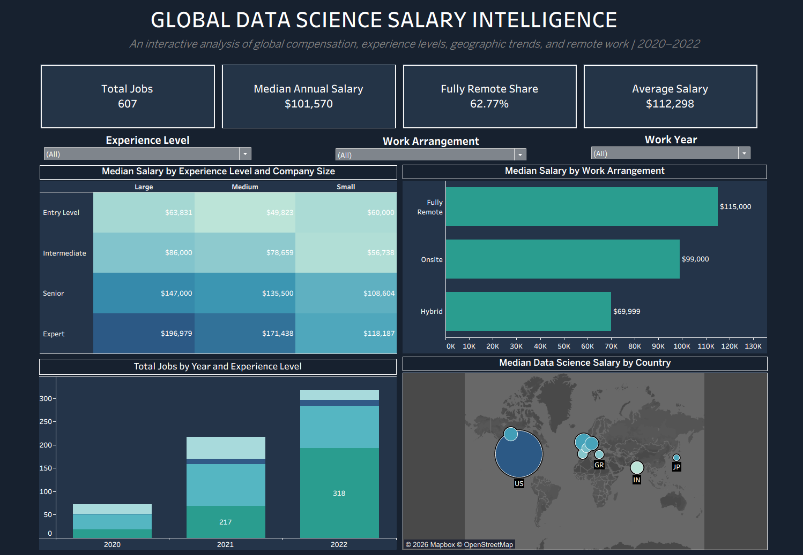

# Global Data Science Salary Intelligence

### Interactive Salary Analytics Dashboard | Tableau | 2020–2022

## Dashboard Preview

## Project Overview

This project analyzes 607 global data science salary records to identify compensation trends across experience levels, company sizes, geographic locations, and remote-work arrangements.

The objective is to transform historical salary data into an interactive business intelligence dashboard that supports compensation benchmarking and workforce analytics.

## Business Questions

- How does compensation vary across experience levels and company sizes?
- What salary differences exist between remote, hybrid, and onsite work arrangements?
- How have data science salary records changed between 2020 and 2022?
- How does median compensation vary across countries?
- What insights can be derived from average versus median compensation?

## Key Performance Indicators

| Metric | Value |
|---|---|
| Salary Records | 607 |
| Median Annual Salary | $101,570 |
| Average Annual Salary | $112,298 |
| Fully Remote Share | 62.77% |

## Key Insights

**1. Remote Work and Compensation**

Fully remote positions have a median annual salary of $115,000, compared with $99,000 for onsite and $69,999 for hybrid positions.

These differences describe the dataset and should not be interpreted as evidence that remote work itself causes higher salaries.

**2. Experience Level and Company Size**

Compensation varies substantially by experience level and employer size. The dashboard enables users to compare median salaries across these segments.

**3. Geographic Salary Differences**

An interactive geographic visualization compares median salaries by company location. Bubble size represents the number of salary records, while color represents median compensation.

**4. Salary Distribution**

The average annual salary ($112,298) exceeds the median ($101,570), suggesting a right-skewed salary distribution.

## Dashboard Features

- Four interactive KPI cards
- Experience-level and company-size salary heatmap
- Median salary comparison by work arrangement
- Yearly salary-record trends segmented by experience level
- Geographic salary analysis
- Interactive filters for experience level, work arrangement, and year

## Tools and Technologies

- **Tableau Public:** Dashboard development and interactive visualization
- **Calculated Fields:** KPI calculations and business metrics
- **Data Analysis:** Salary benchmarking, segmentation, and trend analysis
- **Data Visualization:** Heatmaps, bar charts, stacked charts, and geographic maps

## Interactive Dashboard

[View Dashboard on Tableau Public](https://public.tableau.com/views/AnalyzingGlobalSalariesforDataScienceJobs/GlobalDataScienceSalaryIntelligence)

## Dataset and Limitations

The dataset contains 607 historical salary records covering 2020–2022.

The analysis is descriptive and is not representative of all global data science jobs. Country-level comparisons may be affected by differences in sample sizes, job roles, and experience levels.

Salary values are analyzed in USD.

## Future Enhancements

- SQL-based validation and exploratory analysis
- Additional salary distribution analysis
- Data dictionary and methodology documentation
- Dashboard screenshots and technical implementation notes
